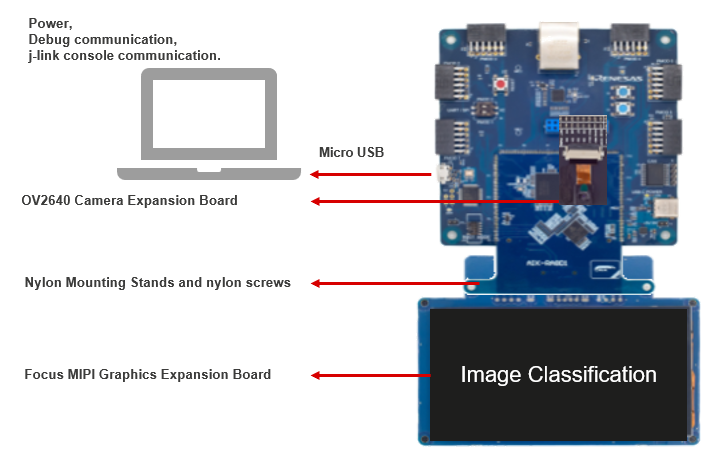

# AIK-RA8D1 Quick Setup Overview

Setting up the RA8D1 platform involves two main tasks:

1. **Installing the e2 studio on host machine** — used for compiling mcu project with learned model.  
2. **Preparing the AIK-RA8D1**

---

## 🧰 Required Equipment
| **Component**                   | **Details**                                                                                           |
|---------------------------------|-------------------------------------------------------------------------------------------------------|
| **AIK-RA8D1**                    | Main board for AI demo execution                                                                      |
| **Micro USB Cable**             | Connects power adapter to the board and deploys the application                                       |
| **Host PC**                     | For e2 studio installation  *OS:* Ubuntu 20.04, 22.04,   Windows 10, 11,   |
| **Camera Expansion Board**      | For connecting parallel camera to AIK-RA8D1 board (included in evaluation kit)                              |
| **MIPI Graphics Expansion Board** | For connecting display to AIK-RA8D1 board (included in evaluation kit)                               |

---

## 🔌 Hardware Connectivity

To run the demo end-to-end with GUI visualization, ensure the following connections:

- `AIK-RA8D1 → Micro USB Cable → Host PC`
- `AIK-RA8D1 → Camera Expansion Board`
- `AIK-RA8D1 → MIPI Graphics Expansion Board`

---

### Hardware Setup Diagram

---

## Hardware limitation
AIK-RA8D1 doesn't have external flash memory. Therefore, the maximum AI model size that can be deployed is limited by the internal flash memory capacity.

1. **Baseline Overhead:** Non-model components require 230.60 KB (11.4% of flash)
2. **Expansion Potential:** The device can accommodate AI models up to 1.744 MB.

### Flash Usage Without AI Model with camera and display enabled

| Category 						  | Size 			|
|---------------------------------|-----------------|
| Total Flash Memory 			  | 2,064,384 bytes |
| Non-Model Flash Usage 		  | 236,130 bytes   |
| Maximum Model Size			  | 1,828,254 bytes |

### Note
- To fit the model into internal memory, you must prune the model using the TAO tool and set an aggressive pruning parameter of 0.7 or higher.
- The effect of pruning varies depending on the situation, so larger parameter settings may be necessary.