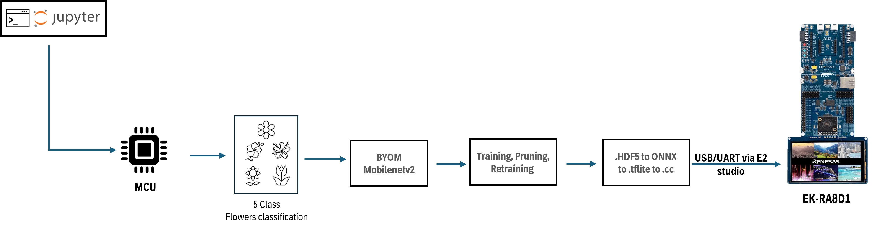
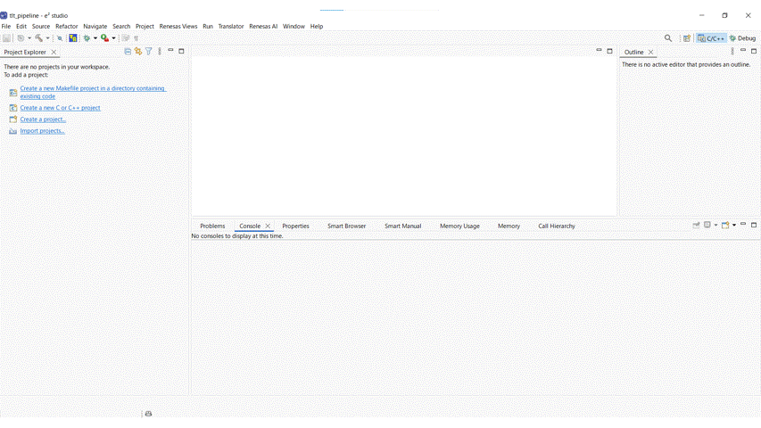

## Introduction

The following example showcases how to use TAO-BYOM feature to use your own model and input it into the NVIDIA TAO infrastructure for retraining and further optimizations.

TAO-BYOM has limitations to what models architecture can be inputted into TAO, image classification and semantic segmentation tasks are currently supported, please vist [TAO-BYOM GitHub](https://github.com/NVIDIA-AI-IOT/tao_byom_examples) for further info.

The pipeline is provided via a Jupyter notebook and requires to follow the same installations steps as for the GUI. The pipepline showcases how you can take a Mobilenetv2 model, input it into NVIDIA TAO tool, train it on TF-Flowers dataset, prune it and deploy it onto EK-RA8D1 board.

For more details, please go through the provided Jupyter notebooks in the directory.

> **Note** : TAO-BYOM has been deprecated in TAO v6.0 and beyond. But still can be used with older versions of TAO which this GitHub is based on.


#### High level flow of BYOM_MobileNet_v2 pipeline



> **Note** : To optimize the pipeline further, developers are encouraged to tune the various hyperparameters in `.yaml` file to achieve better performance.

## Before you start

### Hardware setup 

Ensure you have completed the board setup steps for following boards:
- [EK-RA8D1](../../board_bringup/ek_ra8d1/readme.md)


### Jupyter Notebook setup
Before using the Jupyter Notebooks, make sure the setup scripts have been executed.

1. Copy the `BYOM_Mobilenet_v2` folder from `jupyter_notebooks` folder to the `assets` directory.
    ```
    cp -r jupyter_notebooks/BYOM_Mobilenet_v2/ assets/
    ```
2. Open terminal in application root directory and run below command to start the Jupyter notebook server:
    ```
    ./jupyter-notebook
    ```
3. After server is up, navigate into the `assets/BYOM_Mobilenet_v2` directory and start the jupyter notebook `BYOM_mobilenet_v2.ipynb`
    take care that the selected jupyter kernel is SOS.
4. Select Jupyter notebook kernel as `SoS` and all the cells to be executed with `SoS` kernel.


## How to compile with tflite-micro from e2 studio

In order to integrate the generated model, an application examples have been provided in `root/jupyter_notebooks/BYOM_Mobilenetv2/e2_studio_project` and is currently updated to FSP v6.2. 

Dataset is under biodegradable dataset or flower dataset used for BYOM pipeline.


A simple end-to-end GIF can be viewed below:


For more detailed instructions, please confirm below steps:

- **Step 1** : Open e2 studio and import the project.
- **Step 2** : Replace the `model.cc` file in `src/ai_apps/image_classification` with the model generated by GUI or Jupyter notebook and delete `src/ai_apps/image_classification/model.cc`.
- **Step 3** : Edit `model.cc` as follows:
#### First line
```diff
- unsigned char _home_usr_TAO_TLT_assets_mobilenet_v2_export_model_tflite[] = {
+ #include "BufAttributes.hpp"
+ #include <cstddef>
+ #include <cstdint>

+ namespace arm {
+ namespace app {
+ namespace img_class {


+ static const uint8_t nn_model[] MODEL_TFLITE_ATTRIBUTE =
+ {
```
#### Last line
```diff
- unsigned int _home_usr_TAO_TLT_assets_mobilenet_v2_export_model_tflite_len = 854848;
+ const uint8_t * GetModelPointer()
+ {
+     return nn_model;
+ }

+ size_t GetModelLen()
+ {
+     return sizeof(nn_model);
+ }

+ } /* namespace arm */
+ } /* namespace app */
+ } /* namespace img_class */
```
- **Step 4** : Compile the project by clicking on the build button and confirm that the `.hex` file is generated in the `Debug` folder.
- **Step 5** : Deploy from e2 studio by clicking on the Debug button. You can view the inference result in the MIPI display as standalone.


## Results


The AI inference on MCU board is as follows:

| Board     | Model/dataset  | Inference Time (ms) |
|-----------|----------------|---------------------|
| EK-RA8D1  | TFLite/flowers | 367                 |

> **Note** : Model size and inference speed depend on pruning results. For the same model structure, pruning reductions vary based on learned weights.


