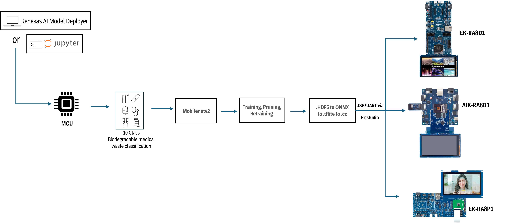
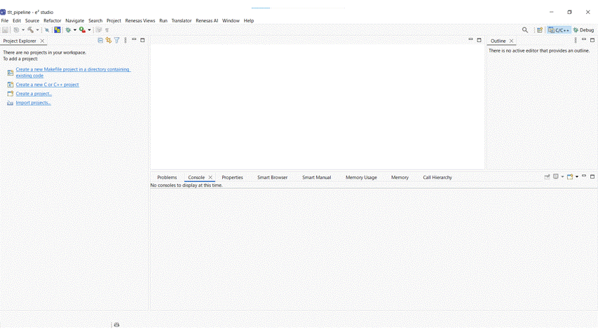

## Introduction

MobileNet_v2 is a deep learning image classification model provided by NVIDIA through TAO. It uses a highly lightweight structure for efficient image processing, making it ideal for real-time applications on embedded systems. Renesas AI Model Deployer leverages MobileNet_v2 backbone and exports to tflite format for tflite-micro, ensuring compatibility with Helium MVE-accelaration of Cortex-M85, RA8D1. The GUI provides access to pruning features from NVIDIA TAO toolkit along with `.yaml` file definition for MobileNet_v2 hyperparameters.

#### High level flow of MobileNet_v2 pipeline



> **Note** : To optimize the pipeline further, developers are encouraged to tune the various hyperparameters in `.yaml` file to achieve better performance.

## Before you start

### Hardware setup 

Ensure you have completed the board setup steps  for [RA8D1](../../board_bringup/ra8d1/readme.md) in its respective READMEs.

### Software setup

#### Model download 
To train the model, download the pretrained weights from Nvidia NGC [here](https://catalog.ngc.nvidia.com/orgs/nvidia/teams/tao/models/pretrained_classification/files?version=mobilenet_v2).   
Please store the `.hdf5` model under `<projectdirectory>/utils/configs/Classification/mobilenet_v2/pretrained_models/`. 

The application code is based on FSP v6.2 and CMSIS-NN 7.0

#### Dataset download

For this demo, an ImageFolder-formatted dataset is used to train a model on ten classes: biodegradable, cardboard, glass, gloves, masks, meficines, metal, paper, plastic, and syringe.

The dataset can be downloaded from [RoboFlow.](https://universe.roboflow.com/gkhang/classification-waste)

The folder structure for the dataset should be as follows:
```
Dataset/
├── Cardboard/     # contains .jpg images of cardboard
│   ├── cardboard1.jpg
│   ├── cardboard2.jpg
│   └── ...
├── Glass/         # contains .jpg images of glass
│   ├── glass1.jpg
│   ├── glass2.jpg
│   └── ...
├── Gloves/        # contains .jpg images of gloves
│   ├── gloves1.jpg
│   ├── gloves2.jpg
│   └── ...
├── ...            # and so on for the remaining 7 classes

```
During inference, input images are classified into one of these ten classes.

#### Runtime/Compiler support
The following pipeline is supported by two runtimes, [Tensorflow lite for microcontroller runtime](https://github.com/tensorflow/tflite-micro) and [Renesas RUHMI AI compiler](https://github.com/renesas/ruhmi-framework-mcu).

## GUI 

To launch the GUI, navigate to project directory:
```bash
./gui_start.sh
```

A simple end-to-end GIF can be viewed below:


For more detailed instructions, please visit [GUI directory](../../gui/readme.md).  

## How to compile from e2 studio

In order to integrate the generated model, application examples have been provided in `root/utils/configs/e2_studio_projects` and are currently updated to FSP v6.2. The projects are arranged in following manner `<board>_RAIMD_<compiler>_biodegradable_fsp_6_2.zip`. Where board is either EK-RA8D1, EK-RA8P1 and AIK-RA8D1. Compilers are  [Tensorflow lite for microcontroller runtime](https://github.com/tensorflow/tflite-micro) and [Renesas RUHMI AI compiler](https://github.com/renesas/ruhmi-framework-mcu).


### Compile with tflite-micro from e2 studio
A simple end-to-end GIF can be viewed below:


For more detailed instructions, please confirm below steps:

- **Step 1** : Open e2 studio and import the project.
- **Step 2** : Replace the `model.cc` file in `src/ai_apps/image_classification` with the model generated by GUI or Jupyter notebook and delete `src/ai_apps/image_classification/model.cc`.
- **Step 3** : Edit `model.cc` as follows:
#### First line
```diff
- unsigned char _home_usr_TAO_TLT_assets_mobilenet_v2_export_model_tflite[] = {
+ #include "BufAttributes.hpp"
+ #include <cstddef>
+ #include <cstdint>

+ namespace arm {
+ namespace app {
+ namespace img_class {


+ static const uint8_t nn_model[] MODEL_TFLITE_ATTRIBUTE =
+ {
```
#### Last line
```diff
- unsigned int _home_usr_TAO_TLT_assets_mobilenet_v2_export_model_tflite_len = 854848;
+ const uint8_t * GetModelPointer()
+ {
+     return nn_model;
+ }

+ size_t GetModelLen()
+ {
+     return sizeof(nn_model);
+ }

+ } /* namespace arm */
+ } /* namespace app */
+ } /* namespace img_class */
```
- **Step 4** : Compile the project by clicking on the build button and confirm that the `.hex` file is generated in the `Debug` folder.
- **Step 5** : Deploy from e2 studio by clicking on the Debug button. You can view the inference result in the MIPI display as standalone.

### Compile with RUHMI framework from e2 studio

A simple end-to-end GIF can be viewed below:


For more detailed instructions, please confirm below steps:
- **Step 1** : Open e2 studio and import the project.
- **step 2** : Convert the tflite model generated by GUI or Jupyter notebook to C-code using the RUHMI Framework. Please refer to the [RUHMI repository](https://github.com/renesas/ruhmi-framework-mcu) for more details.
- **Step 3** : Replace the `{project_root}/src/ai_apps/image_classification/mera` directory with the generated C-code files by RUHMI Framework.
- **Step 4** : Edit `{project_root}/src/ai_apps/image_classification/mera/compute_sub_0000_net1.h` if you use CPU only board as follows:
```diff
+#ifdef __cplusplus
+extern "C" {
+#endif

enum BufferSize_sub_0000_net1 {
#if defined(ARM_MATH_MVEI)
  kBufferSize_sub_0000_net1 = 1431089
#elif defined(ARM_MATH_DSP)
  kBufferSize_sub_0000_net1 = 1429025
#else
  kBufferSize_sub_0000_net1 = 1426737
#endif
};

void compute_sub_0000_net1(
  // buffer for intermediate results
  uint8_t* main_storage, // should provide at least 1426737 bytes of storage
  // inputs
  const int8_t serving_default_args_0_0[150528], // 1,224,224,3
  // outputs
  int8_t PartitionedCall_0_70176[10]  // 1,10
);

+#ifdef __cplusplus
+}
+#endif
```
- **Step 5** : Edit `{project_root}/src/ai_apps/image_classification/wrapper.h` if needed as follows:
#### CPU case with EK-RA8D1 or AIK-RA8D1 board
```c
#include "ai_apps/image_classification/mera/compute_sub_0000_net1.h" // Include path name may vary based on generated files
#include "ai_apps/image_classification/mera/model_io_data.h"

#define MERA_TENSOR_ARENA_SIZE      kBufferSize_sub_0000_net1 // This macro name may vary based on generated files
#define MERA_INPUT_SIZE             model_serving_default_args_0_0_SIZE
#define MERA_OUTPUT_SIZE            model_PartitionedCall_0_SIZE

// model setting
// Quantization parameters are changed based on the trained model.
// Please update by referring to Netron.
#define G_MERA_INPUT_SCALE          0.018658448f
#define G_MERA_INPUT_ZERO_POINT     (-14)
#define G_MERA_OUTPUT_SCALE         0.00390625f
#define G_MERA_OUTPUT_ZERO_POINT    (-128)
```

#### With NPU case with EK-RA8P1 board
```c
static inline uint8_t* mera_input_ptr() {
    return (uint8_t*) GetModelInputPtr_serving_default_args_0_0(); // This function name may vary based on generated files
}

static inline uint8_t* mera_output_ptr() {
    return (uint8_t*) GetModelOutputPtr_PartitionedCall_0_70176(); // This function name may vary based on generated files
}
```
- **Step 6** : Edit quantize parameter if you use NPU as follows:
#### `{project_root}/src/ai_application/image_classification/img_preprocess_c_api.cc`; line 76
```c
        normalize_and_quantize(input, 0.01865844801068306f, -14, // Update input quantization parameters referring to Netron
                    224,
                    224,
                    m_inputTensor->data.int8);
```
#### `{project_root}/src/ai_application/image_classification/MainLoop_img.cc`; line 136
```c
    create_int8_tensor(&outputTensor, output, 0.00390625, -128); // Update output quantization parameters referring to Netron
```

- **Step 7** : Compile the project by clicking on the build button and confirm that the `.hex` file is generated in the `Debug` folder.
- **Step 8** : Deploy from e2 studio by clicking on the Debug button. You can view the inference result in the MIPI display as standalone.

## Results

The results of training can be seen in table below:

| Model              | Model size(FP32) | Accuracy | Remarks |
|--------------------|------------------|----------|---------|
| Trained model      | 27.7MB           | 80.6%    | Includes Adam optimizer state variables. |
| Pruned model       | 4.0MB            | -        |                                          |
| Retrained model    | 11.2MB           | 76.3%    | Includes Adam optimizer state variables. |
| Tflite model       | 1.1MB            | 76.3%    |                                          |

The AI inference on MCU boards is as follows:

| Board     | Model/dataset  | Inference Time (ms) |
|-----------|----------------|---------------------|
| AIK-RA8D1 | RUHMI/Biodegradable    | 685                 |
| AIK-RA8D1 | TFLite/Biodegradable   | 625                 |
| EK-RA8D1  | RUHMI/Biodegradable    | 607                 |
| EK-RA8D1  | TFLite/Biodegradable   | 563                 |
| EK-RA8P1  | RUHMI/Biodegradable    | 1                   |

> **Note:** The inference time for AIK-RA8D1 includes display update processing.

> **Note** : Model size and inference speed depend on pruning results. For the same model structure, pruning reductions vary based on learned weights.

## Sample model accuracy
We provide three sample trained models for quick evaluation. The accuracy of each model is as follows:

| Model type        | Simulation Accuracy | Model size | Used project       |
|-------------------|----------------------|------------|--------------------|
| Biodegradable dataset model_large | 76.3%                | 1092KB     | EK-RA8D1, AIK-RA8D1|
| Biodegradable dataset model_small| 76.3%                | 68KB       | EK-RA8P1           |


> **Note** : Model accuracy is in a trade-off relationship with model lightweighting achieved through pruning.

> **Note** : Pruning is mandatory on the AIK-RA8D1 due to hardware limitations. For details, please refer to the [AIK-RA8D1 board bringup README](../../board_bringup/aik_ra8d1/readme.md).

## Jupyter Notebook
Before using the Jupyter Notebooks, make sure the setup scripts have been executed.

1. Copy the `mobilenet_v2` folder from `jupyter_notebooks` folder to the `assets` directory.
    ```
    cp -r jupyter_notebooks/mobilenet_v2/ assets/
    ```
2. Open terminal in application root directory and run below command to start the Jupyter notebook server:
    ```
    ./jupyter-notebook
    ```
3. After server is up, navigate into the `assets/mobilenet_v2` directory and start the jupyter notebook `mobilenet_v2_RA8D1.ipynb`
    take care that the selected jupyter kernel is SOS.
4. Select Jupyter notebook kernel as `SoS` and all the cells to be executed with `SoS` kernel.
5. Please take care of dataset as you would need to move it to the dataset directory and split it to `train:valid:test` manually.